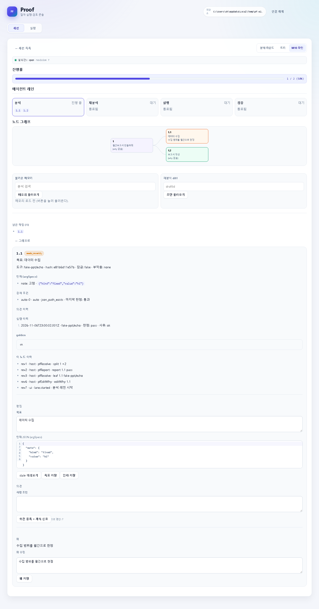
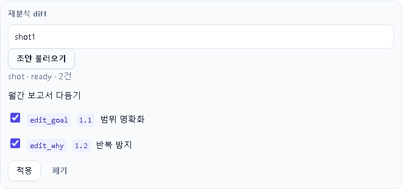

# Proof 사용자 가이드

모델과 대화로 절차서(반복 작업 묶음)를 만들고, 다시 실행하는 방법입니다.
개발·테스트 얘기는 나오지 않습니다.

## 1. 설치·빌드

준비물: Node 20 이상, pnpm.

```powershell
pnpm install
pnpm -r build
```

명령은 두 가지 방법으로 씁니다. 쉬운 쪽부터 확인하세요.

```powershell
node <REPO>/packages/local/dist/cli.js --version
```

버전이 찍히면 됩니다. 매번 경로를 치기 귀찮으면 전역 명령으로 등록합니다.

```powershell
cd packages/local
npm link
proof --version
```

등록 후에는 어느 폴더에서든 `proof`가 됩니다.
지울 때는 `npm uninstall -g @proof/local`입니다.

주의: `pnpm link --global`은 이 저장소의 pnpm 9.0.0에서 실패할 수 있습니다
(전역 bin 미등록 안내 또는 인자 오류). 그때는 `pnpm setup`으로 PATH를 고치거나
위 `npm link`·직접 실행을 쓰세요.

## 2. OpenCode 등록

프로젝트 루트의 `opencode.json`에 Proof MCP를 등록합니다.
`<REPO>`는 Proof 체크아웃 경로, `<저장소 경로>`는 `.procforge/`를 둘 곳입니다.

```json
{
  "mcp": {
    "proof": {
      "type": "local",
      "command": ["node", "<REPO>/packages/local/dist/main.js", "."],
      "enabled": true,
      "environment": {
        "PROOF_DIR": "<저장소 경로>",
        "PROCFORGE_DIR": "<저장소 경로>"
      }
    }
  }
}
```

- `PROOF_DIR`와 `PROCFORGE_DIR`는 같은 값을 씁니다.
- 등록·수정 뒤에는 OpenCode를 재시작합니다 (MCP는 시작할 때 연결됩니다).
- 동작 확인 버전: OpenCode 1.18.32 (Basic auth 포함, 1.18.18은 미검증).

## 3. 첫 절차서 만들기

OpenCode 대화창에서 프롬프트 `procforge_decompose`를 실행하고 요청을 입력합니다
(예: "a.pptx를 9월 월간보고서로 완성해라"). 이후 흐름은 이렇습니다.

1. 모델이 요청을 작은 단계 트리로 나눕니다 (`pf_split`).
2. 각 단계를 실행하고 결과를 보고합니다 (`pf_next` → 실행 → `pf_report`).
3. 실행 가능한 말단 단계는 확정합니다 (`pf_confirm_leaf`).
4. 전부 끝나면 `pf_finalize`로 절차서를 만듭니다
   (`procedures/<이름>/procedure.json`).

모델이 쓰는 도구 21종: `pf_start`, `pf_next`, `pf_report`, `pf_split`,
`pf_confirm_leaf`, `pf_retry`, `pf_ask_human`, `pf_approve`, `pf_advise`,
`pf_tree`, `pf_get_node`, `pf_lock`, `pf_reopen`, `pf_edit_args`,
`pf_edit_node`, `pf_refresh_catalog`, `pf_test`, `pf_finalize`,
`pf_run_start`, `pf_run_next`, `pf_run_supply`.

### MCP 도구 합계 128 초과 시 대처
일부 모델 제공자는 한 번에 받는 도구를 128개로 제한합니다. Proof는
21개를 쓰므로, 다른 MCP와 합친 합계가 128을 넘는지 확인하십시오.
넘으면 쓰지 않는 MCP를 `opencode.json`에서 비활성화하십시오
(`"enabled": false`).

## 4. 다시 실행

확정된 절차서는 대화 없이 CLI로 다시 실행합니다.

```powershell
proof test procedures/<이름> --param month=2026-09
proof run procedures/<이름> --param month=2026-09 --out out/2026-09
```

- `test`는 검증(녹화 내용과 같은지 확인), `run`은 실제 실행입니다.
- `--out <dir>`을 주면 산출물이 그 폴더에 복사됩니다.
- 무인 실행(승인된 것만 자동 진행)은 `--unattended`를 붙입니다.
  외부 영향 단계는 사전 승인(`proof approve`)이 없으면 멈춥니다.
- 누적 파일 둘 곳을 바꾸려면 `--state <dir>`을 씁니다
  (누적 상태 루트, 기본 `.procforge/state`). 덮어쓰기는 `--force`를 씁니다.

## 5. 웹 UI

```powershell
proof ui
```

출력된 주소+토큰으로 브라우저에서 엽니다.

- 세션 목록에서 진행 상황을 보고, 노드에 의견을 답니다.
- 실행 화면에서 절차서를 실행·취소합니다.
- 의견을 남기면 모델이 같은 세션에서 이어서 다시 실행합니다
  (새 세션을 파지 마세요). 이 이어가기(계속 신호)에는 조건이 있습니다.
  OpenCode를 서버 모드로 띄우고 (`opencode serve --port 4096`),
  `proof ui`를 띄우는 터미널에 아래 3개를 설정해야 합니다.

```powershell
$env:PROOF_OPENCODE_URL="http://127.0.0.1:4096"
$env:PROOF_OPENCODE_MODE="b"
$env:PROOF_OPENCODE_TOOL_PREFIX="proof"
```

  `TOOL_PREFIX`는 opencode.json의 MCP 등록 키와 같게 씁니다.
  업데이트 직후에는 OpenCode와 `proof ui`를 모두 재시작합니다
  (구 버전 프로세스가 남으면 잠금이 서로 갈립니다).

## 6. 누적형 절차서

매일·매달 쌓는 CSV처럼 "지난 실행 결과를 다음 실행이 이어받는" 절차서는
`procedure.json`에 선언합니다 (finalize가 만들지 않으므로 수동 추가,
추가 후 승인을 다시 받습니다). 아래 예시는 procedure.json 스키마 통과 확인됨.

```jsonc
// procedures/monthly-2026-09/procedure.json
"accumulate": [{ "path": "sales.csv", "node": "1.3" }]
// 노드 1.3의 args 옆:
// "stateWrites": [{ "key": "lastId", "from": "$1.3.lastId" }]
```

- `accumulate`는 산출 파일이 실행 사이에 보존됩니다 (`.procforge/state/`).
- `stateWrites`는 작은 상태값을 저장하고 `${state.lastId}`로 읽습니다.
- 재확정해도 `state.json`·`approvals.json`·`approved/`는 유지됩니다.
  실행 중인 절차서를 확정하면 거부됩니다 (끝나고 다시 확정하세요).

## 7. 실행 기록 보기

실행 한 번마다 `.procforge/runs/<runId>/` 아래에 남습니다.

- `report.json`: 노드별 결과(pass/fail/…)와 소요 시간, 전체 집계.
- `metrics.json`: 노드 산출 CSV의 행 수.
- `runs/by-procedure/<이름>/latest.json`: 그 절차서의 최근 실행 1건.
- `--out` 복사본은 지정한 폴더에 남습니다.

## 8. M10 확인 화면

세션 상세의 `M10 확인` 탭에서 재분석 초안을 검토하고 순차 실행을 준비합니다.
기존 `분해 라운드`·`트리` 탭은 그대로 둡니다.

- 상단 진행률: 확정된 말단 수 / 말단 수 (예: `3 / 5 (60%)`).
  재검증 대기 노드는 분모에 들어하고 분자에서는 뺍니다.
- 에이전트 레인 4개 (분석·재분석·실행·검증): lane 시작·끝 이벤트가 오면
  해당 레인에 노드 칩이 올라갑니다. 이벤트가 없으면 대기 표시입니다.
- 노드 그래프: 상태 색으로 읽습니다.
  open=회색, probing=파랑, 확인 대기=노랑, pass=초록,
  fail=빨강, 재검증 대기=주황, stale=보라 테두리.
  카드에는 id·목표 1줄·왜 1줄이 보입니다. 카드를 누르면 아래에 상세가 열립니다.
- 노드 상세의 `왜`: 읽기와 `왜 저장`이 있습니다. 1~500자, 다른 변경과
  겹치면 409로 알려주고 초안은 유지됩니다.
- 불러온 메모리: 검색어로 유사 분석을 찾아 목표 목록을 봅니다.
  세션이 연결된 화면에서 불러오면 메모리 로드 기록이 남습니다.
- 재분석 diff: draftId를 넣어 초안을 불러오면 항목별 before/after와 사유가
  보입니다. 적용할 항목에 체크하고 `적용`을 누릅니다.
  적용은 실행 중이 아닐 때만 됩니다 (실행 중이면 409).
  적용 전 판본은 `procedures/<이름>/history/`에 남습니다.
  `다음 실행 때 승인 필요` 목록이 뜨면 해당 노드는 다음 실행 전에
  다시 승인해야 합니다. `폐기`는 화면에서만 지웁니다.
  실행 도구가 없는 순수 분해 노드의 목표 변경은 승인 없이 다음 실행에
  반영됩니다 (history와 "바뀐 노드" 표시로 충분).




### 재분석 모델 고정 (`PROOF_REDRAFT_MODEL`)

재분석 초안은 OpenCode 서버의 모델 1개로 만든다. 형식은
`PROOF_REDRAFT_MODEL=<providerID>/<modelID>` (예: `PROOF_REDRAFT_MODEL=opencode-go/gpt-5.6-luna`).
`PROCFORGE_` 대체 이름은 없다.

- 미설정 시: 서버 `/config/providers`의 첫 default를 쓰고, 초안에 `기본값`으로 기록된다.
- 설정 시: 매 재분석 요청마다 해당 모델이 서버에 있는지 확인한다.
  없으면 초안을 만들지 않고 `모델 없음: <id> (PROOF_REDRAFT_MODEL)`로 거부한다 (400).
  조용히 다른 모델로 바꾸지 않는다.
- 형식이 틀리면(빈 값·`/` 없음·앞뒤 비어 있음) 기동할 때 오류로 끝나고,
  stderr에 변수 이름과 값을 찍는다.

## 9. 주의사항·문제 해결

- OpenCode에 도구가 안 보이면: OpenCode 재시작 → `opencode.json` 경로·오타 확인.
  `PROOF_REDRAFT_MODEL` 형식이 틀리면 MCP와 CLI도 기동하지 않으므로,
  OpenCode에서는 도구가 안 보이는 것으로만 나타난다.
- "카탈로그(schemaHash) 불일치"로 중단되면: 도구 사양이 바뀐 것이니 절차서를
  다시 확정(finalize)하거나 재녹화(`test --mode record`)하세요.
- 실행이 겹치면(`conflict`): 같은 절차서가 이미 돌고 있습니다. 끝나고 다시 하세요.
- 임시 폴더가 쌓이면(`%TEMP%/pf-*`): 저장소 안의 정리 스크립트로 확인합니다.
  먼저 개수만 보고, 지울 때는 `--apply`를 붙입니다.

```powershell
node scripts/tmp-clean.mjs
node scripts/tmp-clean.mjs --apply
```

2일 넘은 `pf-*` 폴더만 지우고, 실행 중인 폴더는 건드리지 않습니다.

## 10. 교훈 (lessons.md)

절차서마다 `procedures/<이름>/lessons.md`에 한 줄 교훈을 모아 둡니다.
유사 분석(불러온 메모리)에 최대 5줄까지 같이 나옵니다.

- 수기 구획: `- `로 시작하는 1줄이 1개 교훈입니다. 500자가 넘으면
  500자에서 잘립니다. 파일이 없어도 정상입니다.
- 자동 구획: `<!-- proof:auto -->` 부터 `<!-- /proof:auto -->` 까지는
  Proof가 다시 씁니다. 집계 숫자(실행 수·노드별 실패 수·평균 소요 시간·
  재승인 수)만 들어가고 문장 요약은 없습니다. 구획 밖 수기 내용은
  바이트 단위로 보존됩니다.
- 갱신: 불러온 메모리에서 절차서를 고른 뒤 `교훈 갱신` 버튼을 누릅니다
  (또는 `POST /api/procedures/:name/lessons/refresh`). 실행 중에는
  conflict(409)로 거부됩니다 (끝나고 다시 누르세요).
- 재finalize해도 `lessons.md`와 `history/`는 그대로 보존됩니다.
